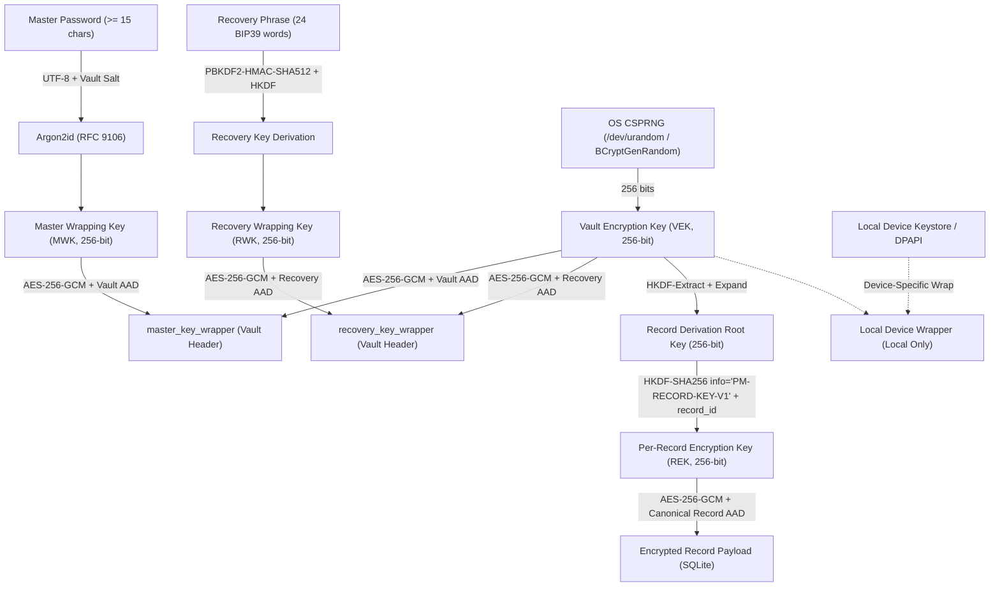

# 10 — Phase 1 Cryptographic Design Proposal

**Document Status:** PROPOSAL / CANDIDATE FOR REVIEW  
**Scope:** Phase 1 — Cryptographic Architecture, Key Hierarchy, Primitives, Library Evaluation & Benchmark Plan  
**Target Environments:** Android (API 26 minimum, API 34 modern) and Windows Desktop  

---

## 1. Executive Summary & Design Principles

This proposal establishes the technical specification for the cryptographic foundation of the Password Manager. In accordance with project guardrails:
1. **No Improvised Primitives:** Only vetted, standard cryptographic algorithms (Argon2id RFC 9106, AES-256-GCM NIST SP 800-38D, HKDF-SHA256 RFC 5869, and BIP-0039) are employed.
2. **Explicit Key Separation:** No single key is ever reused across distinct operational domains or records.
3. **Strict AEAD Nonce Discipline:** Nonce uniqueness under AES-GCM is enforced through architecture to eliminate the risk of nonce reuse.
4. **Canonical Context Binding:** Every ciphertext is cryptographically bound to its format version, vault identifier, record identifier, and purpose code via unambiguous Associated Authenticated Data (AAD).
5. **Fail-Closed Operations:** Any authentication tag mismatch or malformed header immediately aborts the operation without releasing partial plaintext or disclosing timing discrepancies.

---

## 2. Master Password Processing Specification

### 2.1 Character Encoding & Unicode Policy
- **Encoding:** Strict UTF-8 without byte-order marks.
- **Normalization:** In modern cross-platform credential systems, automatic Unicode normalization (e.g. NFKD or NFKC) can alter user intent or break compatibility across platforms. We propose **preserving exact raw input** while recommending NFC normalization only if an explicit cross-keyboard discrepancy is demonstrated. UTF-8 byte sequences are passed directly to the KDF without modification.
- **Whitespace & Casing:** Raw whitespace (including leading, trailing, and internal spaces) and character casing are preserved exactly. Trimming or case folding is strictly prohibited.
- **Length Boundaries:**
  - Minimum: 15 characters (counted by Unicode code points / graphemes per FR-002 and ADR-007).
  - Maximum: 256 characters (to prevent algorithmic Denial of Service in KDF computation).
- **Cross-Platform Parity:** Standard Dart `utf8.encode(masterPassword)` operates identically on Windows and Android, ensuring bit-for-bit parity.

---

## 3. Key Hierarchy & Derivation Architecture

### 3.1 Key Hierarchy Diagram

### 3.2 Key Roles & Portable vs. Device-Local Boundary

| Key Identifier | Size | Purpose | Source / Derivation | Portability |
|---|---|---|---|---|
| **VEK** (Vault Encryption Key) | 256 bits | Primary root key protecting all records in the logical vault | OS CSPRNG at vault creation | **Portable** (encrypted inside wrappers) |
| **MWK** (Master Wrapping Key) | 256 bits | Encrypts/decrypts the VEK in `master_key_wrapper` | Argon2id(MasterPassword, Salt, Params) | Derived locally as needed |
| **RWK** (Recovery Wrapping Key) | 256 bits | Encrypts/decrypts the VEK in `recovery_key_wrapper` | BIP39 Seed -> HKDF-SHA256 | Derived locally as needed |
| **REK** (Record Encryption Key) | 256 bits | Encrypts/decrypts individual credential records | HKDF-SHA256(VEK, Salt, RecordID) | Ephemeral / derived per record |
| **Device Protection Key** | Varies | Unwraps VEK via biometrics or OS credential | Android Keystore / Windows DPAPI | **Device-Local Only** (never exported) |

---

## 4. Key Derivation Function: Argon2id

### 4.1 Specification
- **Algorithm:** Argon2id version 1.3 (`0x13`).
- **Salt:** 16 bytes (128 bits) generated via OS CSPRNG. Unique per vault.
- **Output Length:** 32 bytes (256 bits).
- **Candidate Parameter Profile:**
  - Memory ($m$): $64\text{ MiB}$ ($65,536\text{ KiB}$).
  - Time / Iterations ($t$): 3 iterations.
  - Parallelism ($p$): 4 lanes / threads.
- **Resource Limits & DoS Protection:**
  - Headers specifying $m < 8\text{ MiB}$ or $m > 256\text{ MiB}$ are rejected immediately.
  - Iterations outside $[1, 10]$ are rejected.
  - Parallelism outside $[1, 8]$ is rejected.
- **Upgrade Strategy:** KDF parameters and algorithm identifiers are stored explicitly in the versioned `vault_header`. When higher parameters are approved in the future, the vault automatically re-derives MWK and re-wraps the VEK upon successful unlock.

### 4.2 Benchmark Plan for Hardware Validation
Parameters cannot be finalized based solely on desktop development. Before freezing the KDF profile:
1. **Device Matrix:**
   - Physical Device A: Android 8.0.0 / API 26 (low/mid-range hardware baseline).
   - Physical Device B: Android 14.0 / API 34 (modern flagship/mid-range).
   - Windows 10/11 Desktop environment.
2. **Metrics Measured:**
   - Total derivation latency (target: $\le 1000\text{ ms}$ on API 26, $\le 500\text{ ms}$ on modern devices).
   - Peak RAM consumption during derivation (must not trigger OS low-memory process kills on 2GB RAM devices).
   - UI thread responsiveness (must confirm derivation executes off the main thread in a background Dart isolate or native worker thread).

---

## 5. Authenticated Encryption: AES-256-GCM

### 5.1 Parameter Specification
- **Cipher:** AES-256 in Galois/Counter Mode (GCM).
- **Key Length:** 32 bytes (256 bits).
- **Initialization Vector / Nonce Length:** 12 bytes (96 bits).
- **Authentication Tag Length:** 16 bytes (128 bits).

### 5.2 Nonce Uniqueness & Collision Risk Mitigation
NIST SP 800-38D dictates that random 96-bit nonces under a single key must not be used for more than $2^{32}$ encryptions. However, in local vault storage where records are repeatedly edited and saved:
- **Catastrophic Failure:** Reusing a nonce under the same key in AES-GCM allows an attacker to recover the authentication hash subkey ($H$) and forge or decrypt records.
- **Approved Mitigation Strategy (Per-Record Key Separation):**
  Instead of using a single global key to encrypt all records with random nonces:
  1. Each record utilizes its own **Record Encryption Key (REK)** derived deterministically via HKDF-SHA256:
     $$\text{REK} = \text{HKDF-Expand}(\text{VEK}, \text{info} = \text{"PM-RECORD-KEY-V1:"} \parallel \text{RecordID}, 32)$$
  2. For each write/revision of that record, a fresh 96-bit random nonce is generated by the OS CSPRNG. Because the key is record-specific and record revisions remain well under tens of thousands over the app's lifetime, the probability of a nonce collision under that specific key is virtually zero ($< 2^{-64}$).
  3. Nonce exhaustion or reuse uncertainty triggers an immediate key rotation.

---

## 6. Canonical Associated Data (AAD) & Record Serialization

### 6.1 Canonical AAD Specification
To bind ciphertext immutably to its operational context, all AEAD invocations authenticate the following byte sequence:

| Offset | Length | Type | Description |
|---|---|---|---|
| 0 | 4 | Bytes | Magic ASCII identifier: `PMAA` (`0x50, 0x4D, 0x41, 0x41`) |
| 4 | 2 | uint16 BE | Format version (`0x0001` for Version 1) |
| 6 | 1 | uint8 | Purpose code (`0x01` MasterWrap, `0x02` RecoveryWrap, `0x04` RecordPayload) |
| 7 | 1 | uint8 | Vault ID length ($L_V$) |
| 8 | $L_V$ | UTF-8 | Canonical Vault UUID string |
| $8 + L_V$ | 1 | uint8 | Record ID length ($L_R$, 0 if vault-level wrapper) |
| $9 + L_V$ | $L_R$ | UTF-8 | Canonical Record UUID string (omitted if $L_R = 0$) |
| $9 + L_V + L_R$ | 4 | uint32 BE | Record Version / Revision counter |

### 6.2 Record Payload Serialization
Sensitive record attributes are serialized into a deterministic, canonical JSON format with sorted keys and UTF-8 encoding prior to encryption. This guarantees byte-for-byte serialization reproducibility across Dart on Android and Windows while permitting schema extensibility via versioned payload envelopes.

---

## 7. Recovery Phrase & Derivation Specification

### 7.1 Mnemonic Generation & Validation
- **Entropy:** Exactly 256 bits obtained from OS CSPRNG.
- **Encoding:** BIP-0039 standard English 2048-word list.
- **Checksum:** 8-bit SHA-256 checksum appended to the 256 bits of entropy to form 264 bits (24 words $\times$ 11 bits).
- **Validation:** Strict checksum verification and exact 24-word count enforcement before processing.

### 7.2 Recovery Key Derivation Architecture
To avoid non-standard or unvetted key derivation:
1. The 24-word mnemonic is converted to a 512-bit binary seed using standard BIP39 PBKDF2:
   $$\text{Seed}_{512} = \text{PBKDF2-HMAC-SHA512}(\text{password} = \text{mnemonic}, \text{salt} = \text{"mnemonic"}, c = 2048, \text{dkLen} = 64)$$
2. The 256-bit Recovery Wrapping Key (RWK) is derived using HKDF-SHA256 with domain separation:
   $$\text{RWK} = \text{HKDF-Expand}(\text{PRK} = \text{Seed}_{512}, \text{info} = \text{"PM-RECOVERY-WRAP-V1"} \parallel \text{VaultSalt}, L = 32)$$
3. The RWK decrypts the `recovery_key_wrapper` stored in the vault header to recover the identical 256-bit VEK.

---

## 8. Cryptographic Library Candidates Evaluation

| Package | Evaluated Version | Algorithms Covered | Platforms & API 26 | Maintenance & License | Assessment & Recommendation |
|---|---|---|---|---|---|
| **`cryptography`** (pedroslopez.me) | `^2.7.0` | Argon2id, AES-GCM, HKDF, CSPRNG | Pure Dart fallback + Web/Flutter. Android API 26+ compatible. Windows desktop supported. | Active, BSD-2-Clause. Extensive unit test coverage and standard algorithm parameters. | **Recommended Primary Candidate.** Supports pure Dart & native bindings, implements exact Argon2id and AES-256-GCM primitives. |
| **`pointycastle`** | `^3.9.1` | AES-GCM, Argon2, HKDF | Pure Dart. Compatible with all platforms including API 26 and Windows. | Active community fork of Bouncy Castle. MIT license. | **Viable Alternative.** Slower execution in pure Dart without native acceleration; requires isolates for Argon2id. |
| **`crypto`** (dart.dev official) | `^3.0.6` | SHA-256, HMAC | All Dart platforms. | Maintained by Google/Dart team. BSD-3-Clause. | Useful for standard HMAC-SHA256, but lacks AES-GCM and Argon2id. |
| **`bip39`** | `^1.0.6` | BIP39 wordlist, entropy conversion | Compatible with all platforms. | Stable, MIT license. Wordlist verified against official standard. | **Recommended for BIP39 mnemonic handling.** |

---

## 9. Password Generation Primitives Specification

1. **Unbiased Selection:** Modulo operations (`rand % N`) introduce modulo bias when $2^{32}$ is not divisible by $N$. Bounded integers are selected using **rejection sampling**:
   - Determine threshold $T = 2^{32} - (2^{32} \pmod N)$.
   - Sample 32-bit integer $R$ from CSPRNG. If $R \ge T$, discard and sample again.
   - Return $R \pmod N$.
2. **Fisher–Yates Shuffle:** The generated characters are shuffled in-place using unbiased rejection sampling for every swap index $i$ from $N-1$ down to 1.
3. **Guaranteed Group Representation:** If $K$ character groups are selected and total length $L \ge K$, one character is chosen from each group, followed by $L - K$ unbiased characters from the union pool, completed with an unbiased shuffle.
4. **Passphrase Words:** 6 words selected from a vetted wordlist (e.g. EFF Long Wordlist or BIP39) using unbiased bounded selection.

